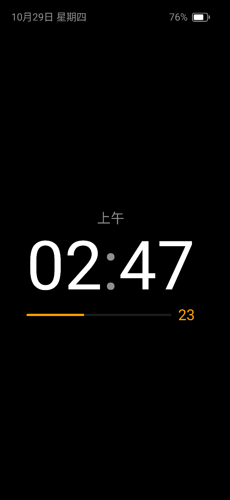
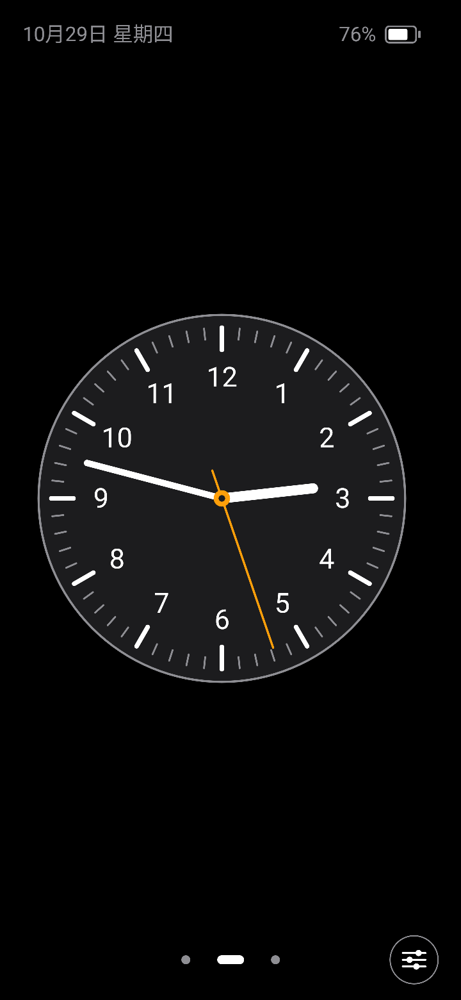
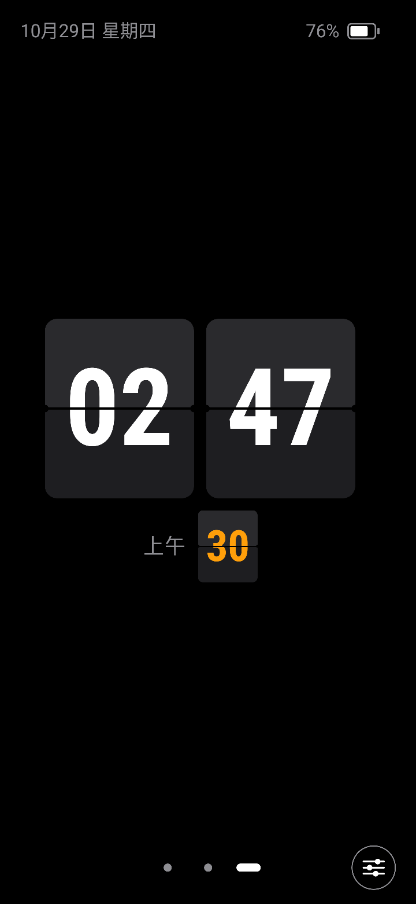
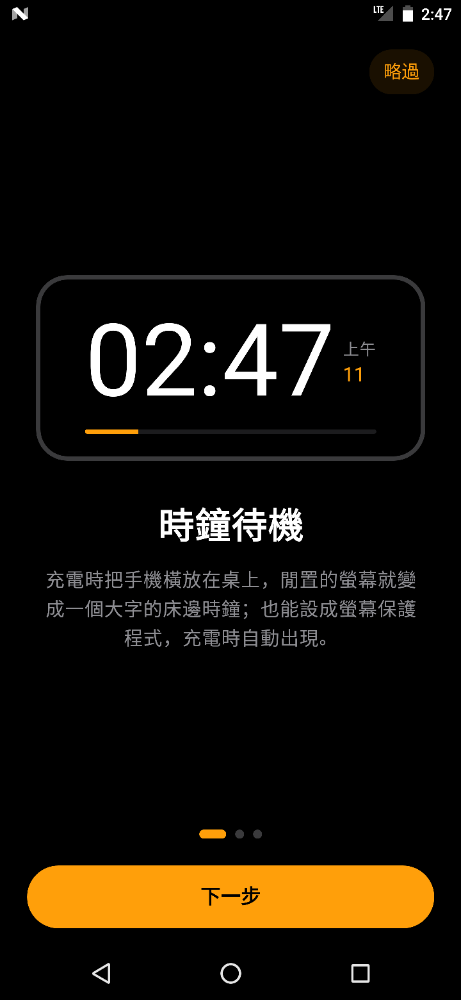
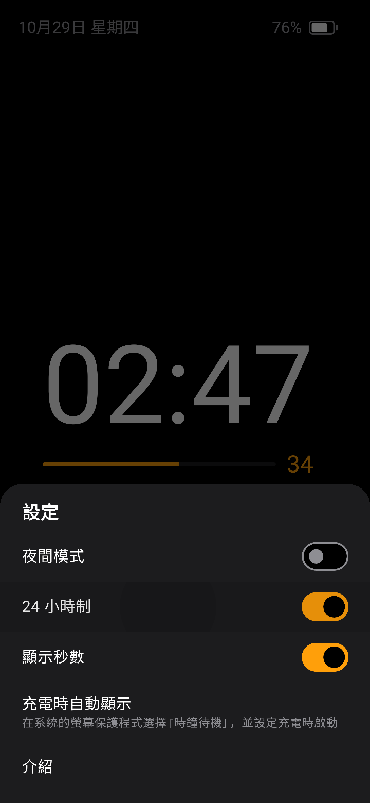
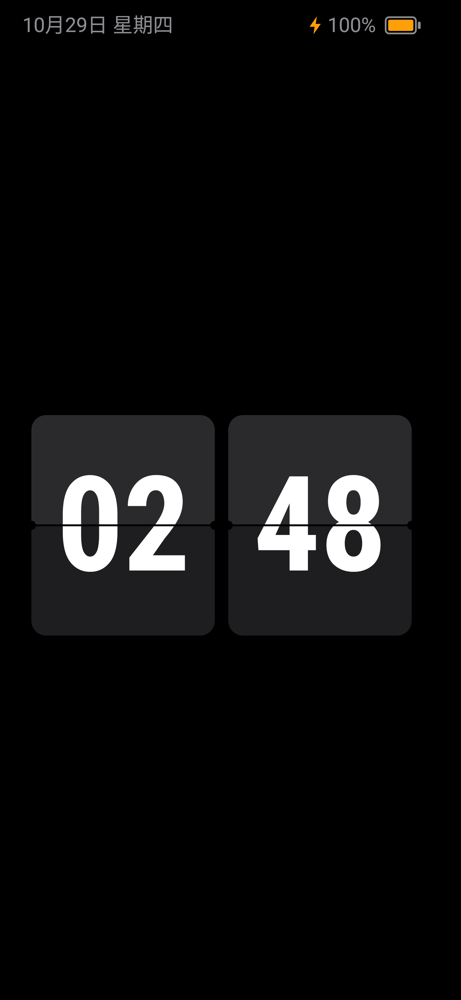
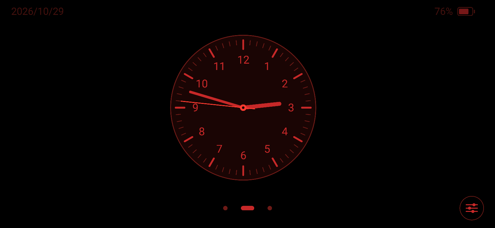
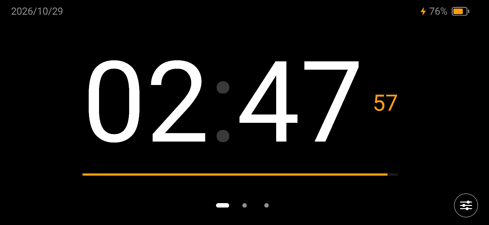
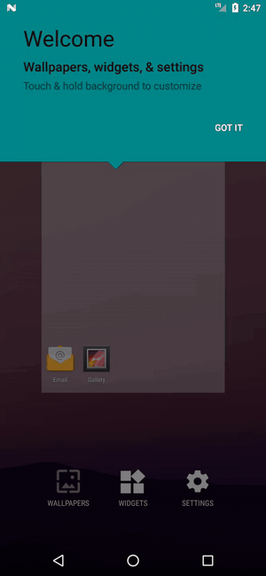
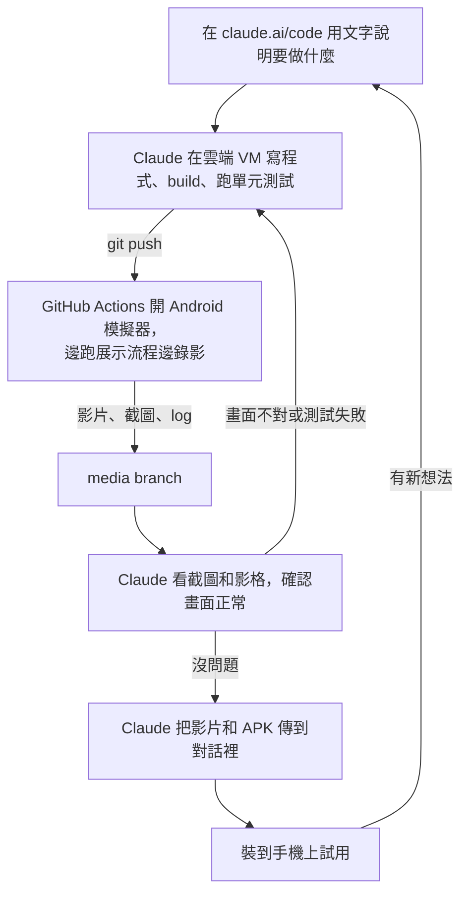

# 時鐘待機（Clock Standby）

把 Android 手機變成床頭鐘的待機 App：三種錶面、夜間模式，充電閒置時自動顯示。

用 Kotlin + Jetpack Compose 寫，支援 Android 7.0（API 24）以上。

這個 App 是**完全遠端開發**的，沒有用自己的機器：沒有裝 Android Studio、Android SDK 或模擬器，
寫程式、build、測試、在模擬器上錄影都在雲端完成。

自己只透過 [claude.ai/code](https://claude.ai/code) 下指令、
看 Claude 回報的截圖和影片，最後把 APK 裝到手機上。

流程和心得寫在[實作流程](#實作流程完全遠端開發)。

**下載**：[APK](../../releases/latest/download/clock-standby.apk) · [展示影片](../../releases/latest/download/demo.mp4) · [Release 頁面](../../releases/latest)（安裝方式見[安裝](#安裝)）

| 數位錶面 | 指針錶面 | 翻頁錶面 |
| :---: | :---: | :---: |
|  |  |  |
| **介紹頁** | **設定面板** | **充電待機（螢幕保護程式）** |
|  |  |  |

| 夜間模式（橫屏） | 充電中（橫屏） |
| :---: | :---: |
|  |  |

**展示影片**

<a href="docs/demo.mp4"></a>

上面是動圖預覽，點一下開原始影片 [`docs/demo.mp4`](docs/demo.mp4)。

## 功能

- **介紹頁**：三頁說明，每頁都有即時運作的錶面預覽
- **待機時鐘**：有數位、指針、翻頁三種錶面，左右滑動或點下方指示點切換；兩指縮放可以調整時鐘大小
  - 預設只顯示時鐘，點一下才出現控制列，5 秒沒操作自動收起
  - 翻頁錶面是真的上下半張翻動，秒數卡的動畫比較短；指針錶面的秒針每秒跳一格，比較省電
- **狀態列**：左上角是日期（橫屏時顯示 `2026/10/28`），右上角是電量與充電狀態
- **設定面板**：點控制列右邊的按鈕打開，可以切換夜間模式、24 小時制、秒數；24 小時制預設跟系統設定，秒數預設顯示
- **夜間模式**：改成低亮度紅色，螢幕亮度也調到最低；畫面每分鐘微移一次，避免烙印；待機時螢幕保持常亮
- **充電待機**：系統的螢幕保護程式，充電閒置時自動顯示時鐘（沿用 App 裡的錶面與設定），不需要常駐服務

## 安裝

到 [Release 頁面](../../releases/latest) 下載 `clock-standby.apk`，在手機上安裝就好（手機要允許「安裝未知應用程式」）。

在雲端開發時也可以直接跟 Claude 說「給我 APK」，它會把 `clock-standby-<commit>.apk` 傳到對話裡。

- 簽 APK 的金鑰每次都不一樣（Release 的每次發佈、每個雲端 session 都是），換裝另一個來源的 APK 時要先移除舊版。
- 要用充電待機：到手機的「設定 > 顯示 > 螢幕保護程式」選「時鐘待機」，啟動時機選「充電時」。
  各家手機的選單位置可能不太一樣。

## 實作流程：完全遠端開發

雲端 VM 可以寫程式和 build，但沒有 Android 模擬器，所以「看畫面」這一步交給 GitHub Actions。
整個循環是這樣：



1. **下指令**：在 claude.ai/code 開 session，選設定好的環境和這個 repo，用文字描述要做的功能。
   環境只要設定一次，步驟寫在 [`docs/cloud-setup.md`](docs/cloud-setup.md)。
2. **雲端寫程式**：session 開始時，環境的 setup script（`scripts/cloud-setup.sh`）已經裝好 Android SDK。
   Claude 照 [`CLAUDE.md`](CLAUDE.md) 的約定寫程式，push 前先在 VM 裡 build debug 版、release 版和錄影用的測試，
   再跑單元測試（`ClockMathTest`）。編譯錯誤、release 版經過 R8 壓縮後缺 class 這類問題，在這一步就會抓到，
   不用等一輪十分鐘的錄影。
3. **push 觸發錄影**：改到 App 程式碼或 Gradle 設定時（只改文件不會），GitHub Actions 會開 Android 7.0 模擬器（Pixel 7 Pro），
   一邊錄影，一邊跑展示流程 `DemoRecordingTest`。
   - 展示流程用 UiAutomator 像真人一樣操作：翻介紹頁、換錶面、開設定、轉橫屏、模擬接上充電器、兩指縮放，關鍵畫面另存截圖
   - 錄完再覆蓋安裝 release 版，三種錶面和螢幕保護程式各拍一張，檢查 R8 壓縮後有沒有閃退
4. **結果推到 media branch**：影片壓縮後每 2 秒抽一張影格，連同截圖和 log 一起 force-push 到 `media` branch，
   也上傳成 Actions run 的 `android-demo` artifact。`main` 的錄影成功時，release APK 和影片另外發佈到 GitHub Release（每次覆蓋）。
5. **Claude 檢查畫面**：雲端 session 用 git 讀 `media` branch，看影格、截圖和 logcat 判斷畫面對不對。
   測試失敗就從 `instrument.txt`、`logcat.txt` 找原因，修好再回到第 2 步。
6. **交付**：確認沒問題後，Claude 把影片和 release APK 直接傳到對話裡，下載裝到手機上試用，有意見再下一輪指令。

### 適合打樣，但很慢

這種方式最大的代價是**慢**。

小東西確實做得出來，很適合拿來打樣、驗證想法，或做這種自己用的小工具。

- **每看一次畫面要等 8～15 分鐘**：模擬器在 GitHub Actions 上，每次都要 push、build（約 3.5 分鐘）、
  開模擬器錄影（約 3.5 分鐘）、壓縮影片，在本機改一行就能看到的東西，這裡一輪要十分鐘左右。
- **只能看截圖和影片判斷**：不能直接操作模擬器，動畫順不順、按鈕好不好按，要等 APK 裝到手機上才知道。
- **CI 模擬器又慢又不穩**：沒有 GPU 的模擬器剛開機時會卡住、系統程式會 ANR，UI 測試要處理很多等待。
- **不適合**：需要反覆調整手感的介面、需要真機硬體（相機、藍牙、感測器），或需要 Google 服務的功能
  （CI 用的是沒有 Google 服務的 AOSP 映像檔）。

想試試看的話，幾個省時間的做法：

- 一次把要改的東西講清楚，讓 Claude 一輪 push 做完，比一次改一點省很多等待。
- 和 Android 無關的計算（時間、角度、電量）放在 `ClockMath`，在 VM 的 JVM 上跑單元測試，幾秒就有結果。
- 只改文件或 CI 設定不會觸發錄影；只想要 APK 時也不用等錄影，在 VM 裡 build 就好。

### GitHub Actions 的額度

GitHub Free 個人帳號的規則如下，整理自 GitHub 文件 [GitHub Actions billing](https://docs.github.com/en/billing/concepts/product-billing/github-actions)（2026-10 查的）：

| 項目 | Public repo | Private repo |
| --- | --- | --- |
| 標準 GitHub-hosted runner | 免費，不扣額度 | 從每月 $12 USD 的額度扣 |
| $12 能跑多久 | 不適用 | Linux 2-core 約 2,000 分鐘、Linux 1-core 約 6,000 分鐘、Linux arm64 約 2,400 分鐘、Windows 約 1,200 分鐘、macOS 約 193 分鐘（用文件的每分鐘單價換算） |
| 額度用完（沒綁卡） | 不受影響 | 停止執行，不會扣款 |
| Self-hosted runner（自己的機器） | 免費 | 免費 |
| Larger runner（加大規格） | 計費 | 只有 Team / Enterprise 方案能扣額度 |
| Larger runner 要不要綁卡 | 要 | 要 |
| GitHub Pages、Dependabot | 免費 | 免費 |
| Copilot code review 的 runner 費用 | 免費 | 扣額度 |
| Artifact 儲存 | 文件沒寫 | 500 MB（和 GitHub Packages 共用） |
| Cache 儲存 | 每個 repo 10 GB | 每個 repo 10 GB |
| 額度重置 | 不適用 | 每個 billing cycle 開始時重置 |
| 儲存空間會不會重置 | 不會 | 不會，歸零的只有累計的儲存費用，檔案要自己刪 |

同樣是免費的 `ubuntu-latest`（[runner 規格](https://docs.github.com/en/actions/how-tos/write-workflows/choose-where-workflows-run/choose-the-runner-for-a-job)），public repo 的機器比較好，跑模擬器會比較快：

- public：4 核心、16 GB RAM
- private：2 核心、8 GB RAM

## 專案結構

```text
app/src/main/java/com/twtrubiks/clockstandby/
├── MainActivity.kt          進入點，讀取設定
├── ClockStandbyApp.kt       第一次開啟看介紹頁，之後直接進待機時鐘
├── IntroScreen.kt           三頁介紹，每頁有即時運作的錶面預覽
├── StandbyScreen.kt         待機時鐘：控制列、設定面板、防烙印、夜間亮度
├── ClockFaces.kt            數位、指針、翻頁三種錶面
├── ClockDreamService.kt     充電待機（系統的螢幕保護程式）
├── ClockSettings.kt         設定，存在 SharedPreferences
├── ClockState.kt            每秒更新的時間、電量廣播
├── ClockColors.kt           配色（夜間模式換成紅色）
└── ClockMath.kt             和 Android 無關的計算，有 JVM 單元測試
app/src/test/…/ClockMathTest.kt              單元測試
app/src/androidTest/…/DemoRecordingTest.kt   錄影用的展示流程（UiAutomator）
.github/workflows/android-record.yml         GitHub Actions：模擬器錄影、發佈 Release
scripts/cloud-setup.sh                       雲端環境的 setup script（安裝 Android SDK）
scripts/ci/record.sh                         在模擬器上錄影、跑 release 版冒煙測試
scripts/update-screenshots.sh                把最新一次錄影的截圖和影片更新到 docs/
docs/cloud-setup.md                          claude.ai/code 的環境設定步驟
CLAUDE.md                                    給 Claude 看的開發約定和流程
```

## 錄影結果與 README 截圖

每次錄影的影片、截圖和 log 都在 `media` branch，也可以到該次 Actions run 下載 `android-demo` artifact。
想自己看的話，`demo.mp4` 是影片，`screenshots/` 是關鍵畫面的截圖。

`media` branch 每次錄影都會被覆蓋（不分 branch），所以 README 用的截圖和影片另外存在 `docs/`。
GitHub README 不能內嵌播放 repo 裡的 mp4，所以 README 顯示的是 workflow 從同一段影片轉出的動圖 `docs/demo.gif`。
畫面改了之後，跟 Claude 說「更新 README 截圖」，它會等錄影成功、看過截圖，再用 `scripts/update-screenshots.sh` 複製到 `docs/`。
這個 script 會擋掉失敗的錄影，以及錄影之後 App 又改過的情況。

⭐ **如果這個專案對您有幫助，請給一個 Star！** ⭐

## Donation

文章都是我自己研究內化後原創，如果有幫助到您，也想鼓勵我的話，歡迎請我喝一杯咖啡 :laughing:

綠界科技ECPAY ( 不需註冊會員 )


[贊助者付款](http://bit.ly/2F7Jrha)

歐付寶 ( 需註冊會員 )


[贊助者付款](https://payment.opay.tw/Broadcaster/Donate/9E47FDEF85ABE383A0F5FC6A218606F8)

## 贊助名單

[贊助名單](https://github.com/twtrubiks/Thank-you-for-donate)
